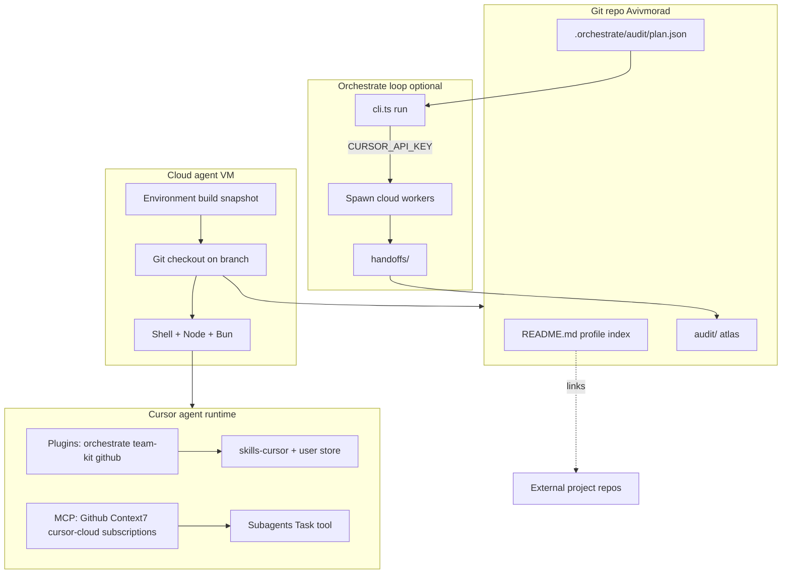

# Architecture — repo, cloud VM, and agent stack

## Data flow for this audit

1. Dispatcher/SDK kickoff created root planner `bc-bbc9707f-...` with goal `audit: ...`.
2. Root planner wrote `plan.json` and committed the `audit/` atlas (orchestrate `run` blocked on missing API key).
3. Downstream agents should read `audit/reference/` before rescanning the VM.

## Trust boundaries

- **Git + disk** — authoritative for orchestrate state when `syncStateToGit: true`
- **Slack** — optional mirror; not required for correctness
- **MCP** — side channels for GitHub, docs, cloud diagnostics; not orchestrate task state
